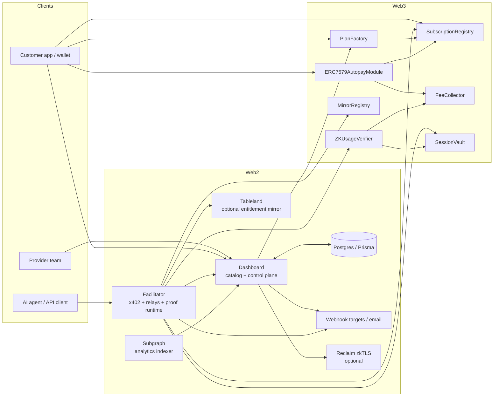
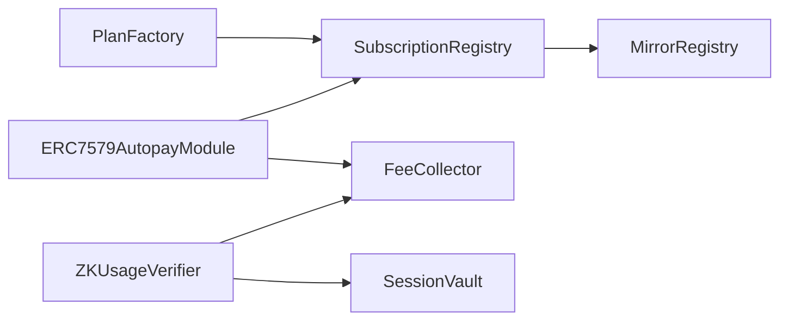
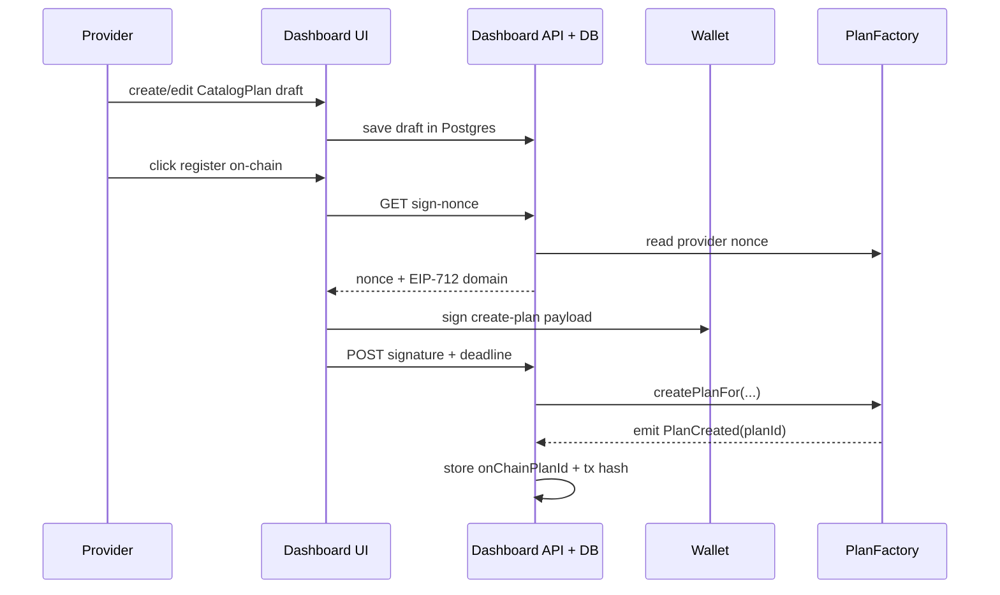
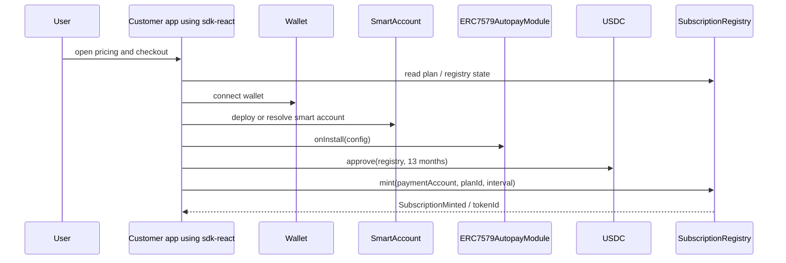
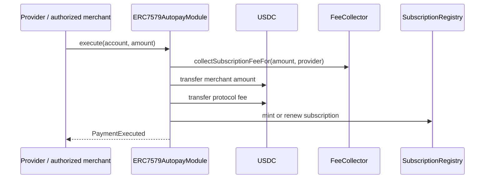
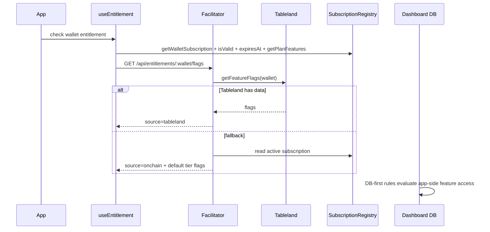
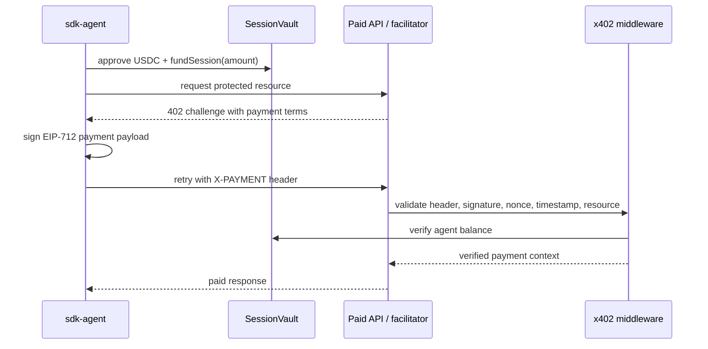
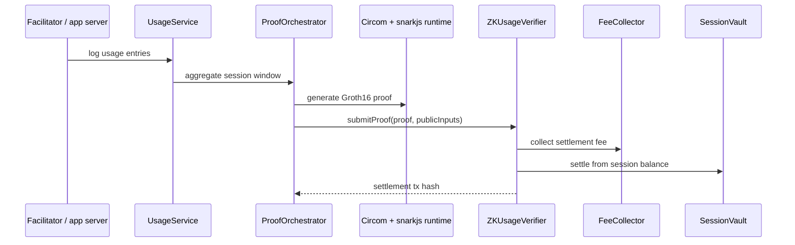
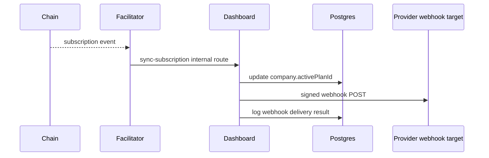
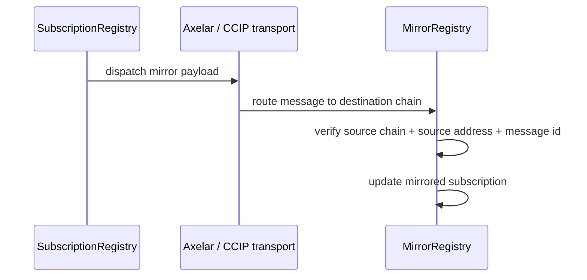

# ArcenPay Product Wiki

Code-audited handoff wiki for the current repository state.

- Audit date: 2026-03-30
- Primary audience: a new engineering team taking over the product
- Scope: architecture, component responsibilities, web2 plus web3 interaction, end-to-end flows, cryptography, and current implementation status

This wiki is intentionally explicit about the difference between:

- `Implemented`: there is real code for it in this repo
- `Operational if configured`: the code path exists, but it depends on env, deployment, or external services
- `Partial / risky`: the design exists, but the current end-to-end wiring has gaps or mismatches

The longer deep-dive appendix still lives in `docs/technical/arcenpay-arcenagent-technical-dossier.md`. This wiki is the practical onboarding map.

## 1. Read This First

ArcenPay is not "just a smart-contract billing app" and it is not "just a SaaS dashboard" either. It is a hybrid system with two product lanes:

1. `Recurring subscription billing for human users`
2. `Usage-based billing for agents and paid APIs`

Those two lanes share the same repo, but they have different centers of gravity:

- Recurring subscriptions center on `PlanFactory`, `SubscriptionRegistry`, and `ERC7579AutopayModule`
- Agent billing centers on `SessionVault`, `x402`, `UsageService`, `ProofOrchestrator`, and `ZKUsageVerifier`

The practical mental model is:

- `Dashboard` is the web2 control plane
- `Facilitator` is the bridge/runtime plane
- `Contracts` are the settlement and entitlement plane
- `Subgraph` and `Tableland` are read-side helpers, not primary truth

There is also legacy naming in the repo:

- `MEAP` is the older platform name still used in many package exports and comments
- `ZKVUB` refers to the zero-knowledge usage-billing subsystem
- `ArcenAgent` or `sdk-agent` refers to the agent-side x402 client flow

## 2. Product In One Page

### What the product is trying to do

ArcenPay gives crypto-native products a way to:

- define paid plans
- collect recurring stablecoin payments
- represent active subscriptions on-chain
- gate product features in web2 and web3 apps
- support machine-to-machine paid API calls
- settle aggregated usage with a zk-backed proof flow

### Where each concern lives

| Concern | Primary owner | Secondary systems |
| --- | --- | --- |
| Plan catalog drafts, teams, invoices, feature rules, API keys | Dashboard + Postgres | PlanFactory for paid on-chain plans |
| On-chain plan registry | PlanFactory | Dashboard relayer flow |
| Subscription validity | SubscriptionRegistry | Dashboard mirror of `activePlanId`, optional Tableland projection |
| Recurring payment execution | ERC7579AutopayModule | FeeCollector, SubscriptionRegistry |
| Agent pre-funded balances | SessionVault | Facilitator, sdk-agent |
| Agent request payment verification | x402 middleware in sdk-node / facilitator | SessionVault |
| zk usage settlement | UsageService + ProofOrchestrator + ZKUsageVerifier | FeeCollector, SessionVault |
| Feature flag evaluation | Dashboard DB-first flag engine | optional Tableland, on-chain fallback |
| Analytics and history | Subgraph | direct chain reads for correctness-critical status |
| Cross-chain entitlement mirroring | SubscriptionRegistry + MirrorRegistry | Axelar/CCIP transports in facilitator |

## 3. Monorepo Map

| Path | Role |
| --- | --- |
| `packages/contracts` | Solidity contracts and Foundry tests |
| `packages/sdk-core` | ABIs, chain config, address registry, shared types |
| `packages/sdk-react` | customer-facing React hooks and checkout UI |
| `packages/sdk-node` | x402 middleware, proof services, transports, Tableland, keeper helpers |
| `packages/sdk-agent` | agent SDK for funding sessions and handling x402 negotiation |
| `apps/arcen-dashboard` | provider dashboard, catalog APIs, DB-backed control plane |
| `apps/facilitator` | bridge service: chain listeners, x402 endpoints, proof runtime, sync, transports |
| `subgraph` | Graph indexer for analytics/history reads |
| `circuits` | Circom circuit and proving scripts for usage settlement |

### 3.1 Best entry points in code

If a new team only reads a handful of files first, these are the right ones:

| File or area | Why it matters |
| --- | --- |
| `packages/contracts/contracts/core/PlanFactory.sol` | on-chain paid-plan registry and EIP-712 meta-plan creation |
| `packages/contracts/contracts/core/SubscriptionRegistry.sol` | subscription NFT lifecycle and biller/bridge permissions |
| `packages/contracts/contracts/core/ERC7579AutopayModule.sol` | intended recurring renewal engine |
| `packages/contracts/contracts/core/SessionVault.sol` | agent pre-funded balance model |
| `packages/contracts/contracts/core/ZKUsageVerifier.sol` | final on-chain usage settlement |
| `apps/arcen-dashboard/app/api/catalog/plans/[id]/register-on-chain/route.ts` | real paid-plan registration flow |
| `apps/arcen-dashboard/lib/flag-engine.ts` | DB-first entitlement and targeting logic |
| `apps/facilitator/src/server.ts` | runtime bridge, chain watchers, sync, entitlement API, cross-chain hooks |
| `packages/sdk-node/src/middleware/x402.ts` | request-level payment verification rules |
| `packages/sdk-node/src/services/usage.ts` | proof runtime behavior, including strict vs dev mode |

## 4. Architecture Overview

### Control plane vs data plane

| Plane | What lives there |
| --- | --- |
| Control plane | plans in draft/published form, team settings, API keys, feature rules, invoices, webhook config, ops endpoints |
| Settlement plane | actual USDC movement, subscription NFT lifecycle, session balances, zk settlement, mirror state |
| Read/index plane | subgraph analytics, Tableland feature projection, dashboard mirrors of on-chain state |

## 5. Web2 Architecture

### 5.1 Dashboard

The dashboard is the main business application. It owns:

- teams, members, provider profile, wallet linkage
- `CatalogPlan` drafts and publishing state
- feature flags and targeting rules
- company and user identity records
- invoices, billing events, webhook delivery logs
- embed access tokens and API keys
- zkTLS proof records

Important detail: the dashboard is not just an admin UI. It is the relayer and translation layer between product configuration and on-chain registration.

### 5.2 Facilitator

The facilitator is the runtime bridge. It owns:

- x402-protected paid endpoints
- session funding and balance-related runtime flows
- usage aggregation and proof orchestration
- on-chain event watching
- sync from chain events back into dashboard DB
- optional Tableland updates
- optional webhook/email delivery
- optional Axelar and CCIP dispatch

If the dashboard is "where providers configure the product", the facilitator is "what keeps live runtime flows moving".

### 5.3 Postgres and Prisma

Postgres is the canonical web2 state store. It is especially important for:

- draft plans and free plans
- company and user identity
- DB-first feature flags
- billing event durability
- webhook delivery logs
- internal reconciliation and operational reporting

### 5.4 Subgraph

The subgraph is used for:

- analytics
- billing event history
- plan and subscriber history
- session and proof submission dashboards

It is explicitly not the source of truth for anything correctness-critical. The repo code says live subscription status and balances should use direct chain reads instead.

### 5.5 Tableland

Tableland is optional. In this architecture it is a distribution and lookup layer for entitlement flags, not the primary business source of truth.

Without Tableland:

- the platform can still function
- the facilitator falls back to in-memory provider-tier flags plus on-chain subscription reads
- `useEntitlement` can still resolve subscription status using chain reads and provider fallback mappings

### 5.6 Webhooks and email

There are two webhook patterns in the repo:

- `dashboard-side outbound webhooks` per provider/team
- `facilitator-side global webhook service` when facilitator env is configured

The dashboard also keeps durable webhook delivery records in Postgres.

## 6. Web3 Architecture

### 6.1 Contract inventory

| Contract | Responsibility | Why it matters |
| --- | --- | --- |
| `PlanFactory` | provider registry and on-chain paid-plan registry | canonical plan IDs for paid plans |
| `SubscriptionRegistry` | subscription NFT lifecycle and validity | canonical on-chain entitlement state |
| `ERC7579AutopayModule` | recurring pull logic for smart accounts | intended renewal engine |
| `FeeCollector` | protocol fee calculation and fee custody | separates merchant amount from protocol fee |
| `SessionVault` | prepaid balances for agents | lets APIs verify spend capacity before service |
| `ZKUsageVerifier` | verifies proof and settles usage billing | final on-chain usage settlement path |
| `MirrorRegistry` | mirrored entitlement state on destination chains | cross-chain read model for entitlements |

### 6.2 Core contract interactions

### 6.3 Current deployed truth

The repo only has concrete non-zero addresses for `Sepolia` at audit time.

| Contract | Sepolia address |
| --- | --- |
| PlanFactory | `0x4F97E0c2Ac053b735640fEb164a08Cb45ba83db1` |
| FeeCollector | `0xa8A0D3007e5680D387A50C1a1E2Eb0AD092ca396` |
| SubscriptionRegistry | `0xE206C519076535A9d24c852093860CFD780908C1` |
| SessionVault | `0xd68b9C0a34d61CC3b3F982A5EC6Cc5a5739e46D9` |
| ZKUsageVerifier | `0x1f75d66692416cE880d51Baf6CdcBeE98E5837c0` |
| ERC7579AutopayModule | `0xc82417e378b23AD9Ae73229EF08a4BA7896a4351` |
| MirrorRegistry | `0xC187CD32d569ec0E84B9b378f8E63f3a74afac74` |

`Base Sepolia` and `Base Mainnet` are still zero-address placeholders in `packages/sdk-core/src/addresses.ts`, so multi-chain production should not be assumed from package exports alone.

## 7. State Ownership: What Is Canonical?

| Data | Canonical source | Notes |
| --- | --- | --- |
| paid plan definitions | `PlanFactory` | free plans never go on-chain |
| plan drafts, copy, metadata editing status | dashboard DB | draft/publish workflow is web2-first |
| active subscription validity | `SubscriptionRegistry` | dashboard mirrors `activePlanId` for app logic |
| feature rules | dashboard DB | Tableland is optional projection, not source of truth |
| agent available balance | `SessionVault` | checked by x402 middleware |
| usage proof settlement | `ZKUsageVerifier` + `SessionVault` | proof runtime is off-chain, final settlement is on-chain |
| analytics/history | subgraph | eventual consistency accepted |
| cross-chain mirror validity | `MirrorRegistry` on destination chain | only matters if cross-chain is actually deployed and wired |

## 8. End-to-End Flows

### 8.1 Plan creation and on-chain registration

This is the first major thing a new team should understand:

- there is no single "create plan" SDK call that fully handles the product workflow
- the real flow is mixed web2 plus web3
- free plans stay off-chain
- paid plans are drafted in DB, then registered on-chain via signed EIP-712 payload plus relayer submission

What this means in practice:

- `CatalogPlan` is the authoring surface
- `PlanFactory` is the paid-plan registry
- the dashboard relayer is part of the core architecture, not a convenience layer

Important constraints:

- free plans cannot be registered on-chain because `PlanFactory` requires `price > 0`
- billing interval must be at least 30 days
- provider must already be registered in `PlanFactory`

### 8.2 Customer checkout and initial subscription mint

What the code is trying to do:

- fetch plan data from `PlanFactory`
- optionally deploy a ZeroDev smart account
- install the autopay module
- approve USDC
- mint the initial subscription

Important reality check:

- `SubscriptionRegistry.mint` is guarded by `onlyBiller`
- the checkout UI currently calls `mint(...)` directly from the customer-side flow
- unless the caller account is already an authorized biller, this direct mint path will fail on a real deployment

There is another important assumption:

- the checkout UI calls `ERC7579AutopayModule.onInstall(...)` directly on the module address
- the contract comments say production should call through the smart-account execution framework
- so the current UI flow assumes a specific smart-account integration model that may not hold universally

Conclusion: the checkout flow is implemented, but the current end-to-end mint/install behavior should be treated as `implementation-risk`, not as fully proven production flow.

### 8.3 Intended recurring renewal flow

The intended recurring-payment design is contract-driven:

This is the architecture the contracts are designed for.

However, a new team should verify who runs `execute(account, amount)` in production:

- the merchant/provider is the allowed caller
- there is no obvious separate production merchant billing daemon in this repo that definitively owns this renewal loop
- the contract path is real, but the operational owner of renewals needs to be made explicit

### 8.4 Entitlement and feature-flag resolution

The important distinction is:

- `subscription validity` is chain truth
- `feature rule targeting` is DB truth
- `Tableland` is optional distribution/cache

### 8.5 Agent money flow with x402

What is good about this design:

- the API can fail closed if balance checks fail
- anti-replay exists via timestamp window and nonce store
- the agent only advances its local nonce when it receives a successful paid response

### 8.6 zk usage settlement flow

This subsystem has two runtime modes:

- `strict`: real proof tooling and artifacts must be present
- `dev`: proof generation can fall back to a deterministic zero-proof envelope for development

That makes local development easier, but it also means "tests passed" does not automatically mean "strict proving is fully operational".

### 8.7 Dashboard sync, webhooks, and external system integration

This is the main "web2 plus web3 together" bridge for provider-facing systems:

- on-chain events update web2 customer state
- web2 notifications and webhooks are triggered from that mirrored state

### 8.8 Cross-chain mirror flow

Intended design:

The contract-side idea is sound:

- source registry dispatches mirror payload
- destination `MirrorRegistry` verifies trusted source and deduplicates message IDs

But the currently wired off-chain relay path has meaningful gaps, described in Section 11.

## 9. Data Model You Need To Understand

### 9.1 Key dashboard tables

The most important Prisma models for handoff are:

- `Team`, `TeamMember`, `ProviderProfile`
- `CatalogPlan`
- `ArcenCompany`, `ArcenUser`
- `CatalogFeatureFlag`, `FlagRule`, `FlagRuleCondition`, `CompanyOverride`
- `BillingEvent`, `WebhookDelivery`
- `ArcenApiKey`, `EmbedAccessToken`
- `ZkTlsProof`

### 9.2 Why these matter

| Model | What it does |
| --- | --- |
| `CatalogPlan` | authoring state for plans before and after on-chain registration |
| `ArcenCompany` | maps customer identity into dashboard business state |
| `activePlanId` on `ArcenCompany` | DB-side mirror of which plan a company currently has |
| `CatalogFeatureFlag` + rules | app entitlement logic independent of chain-specific boolean checks |
| `BillingEvent` | durable record of billing-related events and reconciliation |
| `WebhookDelivery` | evidence of external integration success/failure |
| `ZkTlsProof` | verified external-claim storage used by the flag engine |

## 10. Cryptography Inventory

| Mechanism | Where used | Purpose | Current state |
| --- | --- | --- | --- |
| EIP-712 signed plan creation | `PlanFactory.createPlanFor` | gasless relayed paid-plan registration | implemented and used by dashboard |
| EIP-712 x402 payment signing | agent SDK + x402 middleware | request-level payment authorization | implemented and tested |
| HMAC-SHA256 | dashboard access tokens and webhook signing | integrity/authentication for web2 integrations | implemented |
| Groth16 proofs | circuits + `UsageService` + `ZKUsageVerifier` | usage settlement with proof-backed aggregate claims | implemented, but strict runtime depends on artifacts/tooling |
| Nullifiers | `ZKUsageVerifier` and proof orchestration | prevent double settlement | implemented |
| zkTLS via Reclaim | dashboard zkTLS route + proof storage | prove web2 claims without exposing raw credentials | optional and not fully active in this workspace |

## 11. What Is Actually Working Right Now

This section is the most important handoff section.

### 11.1 Confirmed working from code plus local audit

| Subsystem | Status | Notes |
| --- | --- | --- |
| Core contract suite | implemented | contract tests passed in audit session |
| `sdk-core` | implemented | address/ABI/type layer works |
| `sdk-react` basic read paths | implemented | plan reads and entitlement reads are real |
| `sdk-node` x402 and usage services | implemented | tests passed |
| `sdk-agent` | implemented | funding and x402 negotiation path exists |
| Dashboard APIs | implemented | tests passed |
| Facilitator server | implemented | test/typecheck passed |
| Subgraph build | implemented | builds successfully for Sepolia indexer |

### 11.2 Works if configured

| Subsystem | Status | What it needs |
| --- | --- | --- |
| Tableland entitlement projection | optional | `TABLELAND_TABLE_NAME` and write-capable Tableland config |
| Webhooks | optional | provider webhook URL and secret, or facilitator webhook env |
| Email | optional | Resend API key |
| zkTLS | optional | Reclaim SDK package plus app credentials |
| strict zk proving | conditional | compiled artifacts, verification key, proving script, snarkjs runtime |
| cross-chain transport adapters | conditional | real destination deployments and bridge/router configuration |

### 11.3 Partial or risky today

#### A. Checkout mint path likely mismatches contract permissions

Why:

- `SubscriptionRegistry.mint` is `onlyBiller`
- `CheckoutModal` directly calls `mint(...)`

Implication:

- the current customer checkout path should not be assumed to succeed on a locked-down production deployment without additional biller authorization or a relayed mint layer

#### B. Autopay install flow is UI-driven but contract comments expect smart-account execution framework

Why:

- `CheckoutModal` calls `onInstall(...)` directly
- the contract explicitly says production would call through the smart account's execution framework

Implication:

- the smart-account integration contract should be revalidated before claiming universal ERC-7579 compatibility

#### C. Cross-chain relay wiring has concrete mismatches

There are at least four issues:

1. `SubscriptionRegistry` emits route constants `1` for Axelar and `2` for CCIP, but the facilitator watcher treats `0` as Axelar and `1` as CCIP.
2. The facilitator watcher builds a minimal payload containing only `tokenId`, while `MirrorRegistry` expects a fully decoded subscription payload.
3. The transport adapters are initialized with `CONTRACTS.mirrorRegistry` from the current chain, which assumes the destination mirror lives at the same address.
4. Base-network addresses are still zero placeholders in `sdk-core`.

Implication:

- cross-chain is architected and partly unit-tested, but not handoff-safe as a production-ready end-to-end claim

#### D. zk proof runtime is only fully real in strict mode with artifacts present

Why:

- the facilitator enforces `strict` in production profile
- local/dev mode can fall back to zero-proof envelopes
- the `circuits` package currently lacks `snarkjs` in this workspace

Implication:

- the usage-billing architecture is real, but strict proof operations still need final runtime hardening and deployment discipline

### 11.4 Not active in this workspace during audit

| Subsystem | Audit conclusion |
| --- | --- |
| Tableland write path | not active |
| zkTLS via Reclaim | not active |
| strict proving toolchain in `circuits` | not active |
| deployed Base/Base Sepolia contract stack | not active |

## 12. Direct Answers To Your Specific Questions

### Is Tableland currently working?

`Not as an active configured service in this workspace.`

What is true:

- the Tableland service code is real
- the facilitator only starts it when `TABLELAND_TABLE_NAME` is configured
- the example env explicitly says it falls back to in-memory flags when that variable is unset

So the platform can run without Tableland, but persistent Tableland-backed entitlement distribution is currently optional rather than foundational.

### Is the subgraph really used?

`Yes, but for analytics and history, not for correctness-critical live state.`

That is actually a healthy design choice:

- dashboard analytics and history use the subgraph
- live subscription checks and balances are expected to use direct contract reads

Also:

- the subgraph config in this repo is Sepolia-only
- the subgraph package builds successfully
- the repo does not have real subgraph tests yet

### Is zkTLS really working?

`Designed and partially integrated, but not operational in this workspace today.`

What exists:

- zkTLS proof route
- DB model for storing verified proofs
- flag-engine support for `zktls_claim` conditions

What is missing in this workspace:

- `@reclaimprotocol/js-sdk`
- required Reclaim app credentials

### Is cross-chain really working?

`Not in a way I would hand off as production-ready today.`

What is real:

- contract support exists
- transport adapters exist
- mirror registry exists

What blocks a strong "yes":

- non-Sepolia deployments are placeholders
- relay route interpretation is mismatched
- relay payload encoding is mismatched
- destination addressing assumptions are weak

### Is the money flow working?

`Partly yes, but the answer depends on which lane you mean.`

For `agent / x402 / SessionVault / usage billing`:

- the architecture is coherent
- the code paths are real
- the main remaining concern is strict proving runtime readiness

For `subscription checkout and recurring billing`:

- the contracts are real
- the UI flow exists
- but the current initial mint path likely needs a biller/relayer correction before it should be treated as production-safe

## 13. Deployment and Environment Strategy

### 13.1 Current network reality

| Network | State |
| --- | --- |
| Sepolia | actual deployed contract set present in repo |
| Base Sepolia | placeholders in address registry |
| Base Mainnet | placeholders in address registry |

### 13.2 External dependencies by importance

#### Required for core recurring plus agent product

- RPC endpoint
- deployed Sepolia contracts
- dashboard Postgres
- facilitator secret alignment

#### Required for strict production-grade usage proving

- proving artifacts
- verification key
- proof signer key
- `PROOF_MODE=strict`

#### Optional integrations

- Tableland
- Reclaim zkTLS
- Resend
- Axelar
- CCIP

## 14. Test And Audit Evidence

During this audit session, the following checks were already completed:

| Check | Result |
| --- | --- |
| `npm --workspace packages/sdk-core test` | passed |
| `npm --workspace packages/sdk-agent test` | passed |
| `npm --workspace packages/sdk-node test` | passed |
| `npm --workspace packages/sdk-react test` | passed |
| `npm --workspace packages/contracts test` | passed |
| `npm --workspace apps/arcen-dashboard test` | passed |
| `npm --workspace apps/facilitator test` | passed |
| `npm --prefix subgraph run build` | passed |
| `npm --prefix circuits test` | failed because `snarkjs` was missing in the workspace |

Interpretation:

- the repo is not broken overall
- the core contract and app layers are in reasonably good shape
- the proving toolchain still needs final operational readiness work

## 15. Recommended Handover Priorities

If a new team takes over, this is the order I would use.

1. `Fix the subscription checkout permission model`
   - decide whether initial mint is relayed, biller-authorized, or executed through the autopay path

2. `Write down the true renewal operator`
   - define exactly who calls `ERC7579AutopayModule.execute(...)`, when, and from what service

3. `Decide whether Tableland is strategic or optional`
   - if strategic, fully configure and operate it
   - if optional, keep it clearly documented as a cache/projection layer only

4. `Finish strict zk proof runtime hardening`
   - artifact packaging
   - dependency installation
   - environment validation
   - deployment runbooks

5. `Treat cross-chain as a separate hardening project`
   - deploy non-Sepolia chains
   - fix route-value mismatch
   - fix payload encoding mismatch
   - document bridge trust and destination addresses

6. `Decide whether zkTLS is MVP-critical`
   - if yes, install Reclaim, wire credentials, add operational tests
   - if no, keep it documented as optional and avoid selling it as already live

## 16. Bottom-Line Summary

ArcenPay today is best understood as:

- `a real hybrid billing architecture`
- `with strong Sepolia-first contract foundations`
- `a real dashboard plus facilitator control/runtime split`
- `a credible agent billing lane`
- `a recurring billing lane that is architecturally good but still needs one important permission-flow correction`
- `optional modules like Tableland and zkTLS that are present but not mandatory`
- `a cross-chain story that exists in design and code, but still needs end-to-end hardening before it should be treated as live`

If a new team starts from this wiki, the safest assumption is:

- `Sepolia recurring + dashboard + x402 + SessionVault + analytics` are the current core
- `strict proving, cross-chain, zkTLS, and Tableland-heavy operation` still need explicit activation and final hardening
